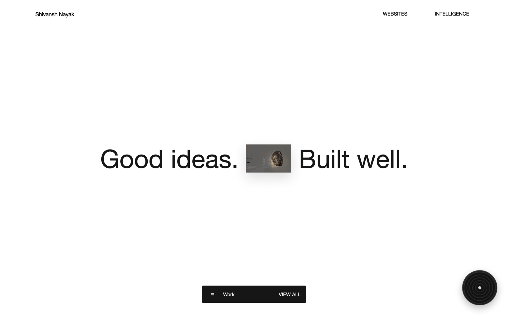
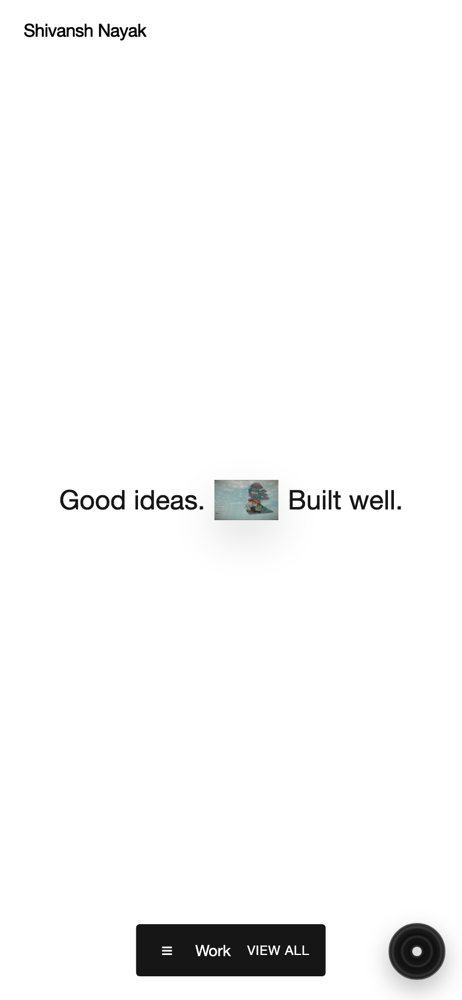
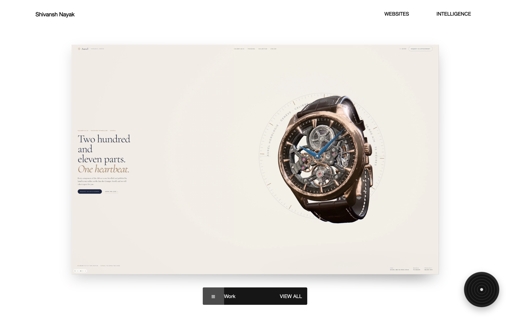
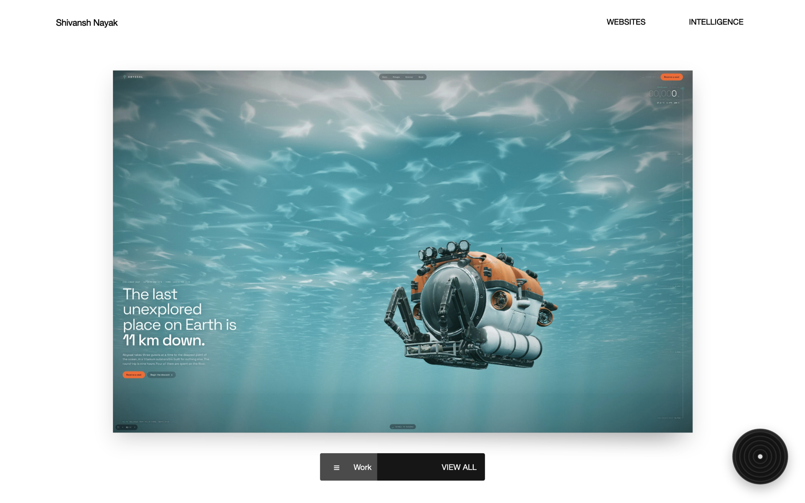
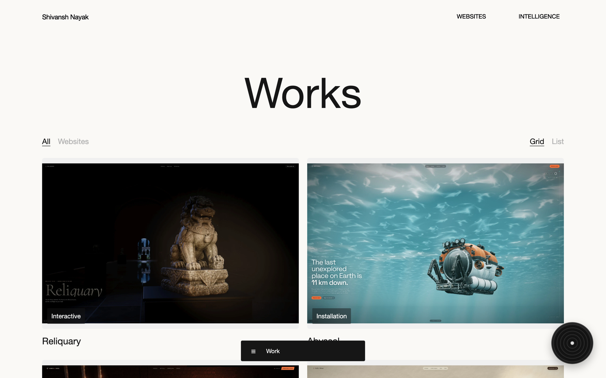
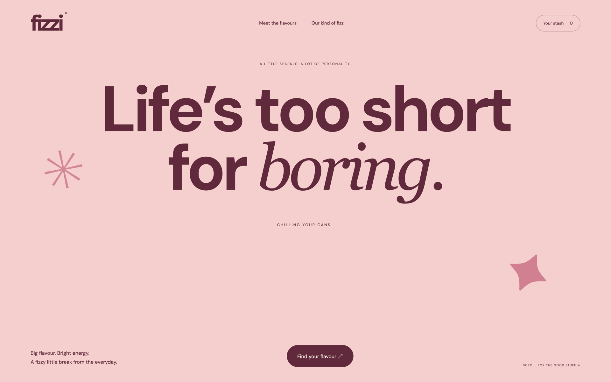

<div align="center">

# Shivansh Nayak — Digital Portfolio

**Creative Engineering · Interactive 3D · AI Agents & Automation**

[](https://vitejs.dev/)
[](https://threejs.org/)
[](https://greensock.com/)
[](https://lenis.darkroom.engineering/)
[](https://rapier.rs/)

<br>



<br>
<em>Desktop opening hero sequence with real-time card expansion and crossfading showcase studies.</em>

</div>

---

## Overview

A modern multi-page portfolio and digital showcase engineered with **Vite**, **Three.js**, **GSAP**, and **Lenis**. The platform demonstrates high-fidelity front-end craft across four core services — **Website Development**, **Software Engineering**, **AI Agents & Automation**, and **Strategic Writing & Design** — accompanied by **twenty self-contained interactive 3D WebGL studies**.

---

## Visual Showcase

<div align="center">

### Desktop & Mobile Parity

<table>
  <tr>
    <td width="65%" valign="top">
      
      <p align="center"><b>Desktop Experience</b><br>Geometric card stack handoff, contextual navigation, and fluid viewport scaling.</p>
    </td>
    <td width="35%" valign="top">
      
      <p align="center"><b>Mobile Viewport (390×844)</b><br>Exact visual parity, responsive card aspect ratio, and touch-optimized navigation.</p>
    </td>
  </tr>
</table>

### Selected Works & Interactive Rail


<p align="center"><em>Interactive project showcase featuring card stacks, dynamic depth transforms, and seamless scene navigation.</em></p>

### Service Explorations


<p align="center"><em>Modular multi-panel breakdown covering Websites, Software, AI Development, and Writing.</em></p>

### Studies Archive & Standalone Experiences

<table>
  <tr>
    <td width="50%" valign="top">
      
      <p align="center"><b>Works Archive</b><br>Curated directory of 20 interactive 3D WebGL scenes and case studies.</p>
    </td>
    <td width="50%" valign="top">
      
      <p align="center"><b>Fizzi 3D Storefront</b><br>Real-time PBR material rendering, environment mapping, and interactive flavor selection.</p>
    </td>
  </tr>
</table>

</div>

---

## Key Features & Architecture

- **Weighted Inertia Smooth Scroll**: Powered by Lenis v1.3 with calibrated physical damping (`lerp: 0.045`, `wheelMultiplier: 0.75`), delivering a viscous, high-momentum glide across all viewports.
- **Mobile Touch Inertia**: Integrated `syncTouch: true` with exponential inertia decay (`touchInertiaExponent: 1.65`), giving touchscreens the same smooth gliding physics as high-end desktop trackpads.
- **Cinematic Hero Opening**: Zero-layout-thrashing Hermite smoothstep cubic interpolation coordinated through a single `requestAnimationFrame` loop, ensuring sub-pixel alignment (`<0.05px`) between deck cards and expanding hero views.
- **20 Standalone WebGL Studies**: Real-time 3D environments rendered in Three.js and Rapier3D, featuring custom post-processing pipelines, contact shadows, procedural materials, and ambient lighting.
- **Calm Auto-Scroll Navigation**: Floating dock navigation with auto-scroll calibrated to a readable, steady ~280px/s across all studies.
- **Client-Side AI Inference**: Browser-native Transformer models via `@huggingface/transformers` for local text analysis and heuristics without server roundtrips.
- **Fail-Safe WebGL Recovery**: Fallback still preview and recovery dialogue if a client device lacks WebGL2 hardware acceleration or network timeouts occur.

---

## Project Structure

```text
Portfolio-main/
├── docs/                     # Architecture documentation and retina screenshots
│   └── screenshots/          # High-resolution UI captures
├── scripts/                  # Automated verification & test suites
│   └── check-studies.mjs     # 3D GLB & entrypoint integrity suite
├── vite.config.js            # Multi-page build configuration & route generation
└── web/
    ├── diorama-core/         # 3D diorama foundation & shared camera controllers
    ├── examples/             # 20 standalone WebGL 3D study entrypoints
    │   ├── abyssal/
    │   ├── artemis/
    │   ├── atlas/
    │   ├── ...
    │   └── velocity/
    ├── fizzi/                # Standalone 3D soda storefront adaptation
    ├── shared/               # Shared CSS tokens & common UI components
    ├── site/                 # Main portfolio application
    │   ├── data.js           # Profile, services, studies & journal data
    │   ├── home.js           # Opening transitions & interactive sections
    │   ├── shell.js          # Global shell, Lenis scroll & navigation
    │   └── site.css          # Core design system & responsive layouts
    ├── src/core/             # Shared Three.js runtime, engine & loaders
    └── substance/            # Procedural material & gem showcase adaptation
```

---

## Getting Started

### Prerequisites

- [Node.js](https://nodejs.org/) v18.0.0 or higher
- [npm](https://www.npmjs.com/) v9.0.0 or higher

### Installation & Local Development

1. **Clone the repository:**
   ```bash
   git clone https://github.com/Mr-Nayak20/Portfolio.git
   cd Portfolio
   ```

2. **Install dependencies:**
   ```bash
   npm ci
   ```

3. **Start the local development server:**
   ```bash
   npm run dev
   ```
   Open [http://127.0.0.1:5173/](http://127.0.0.1:5173/) in your browser.

### Production Build & Verification

```bash
# Compile and optimize production assets to dist/
npm run build

# Validate all 20 study entrypoints, GLB geometries, and asset paths
npm run check:studies

# Preview the production build locally
npx vite preview --port 5174
```

---

## Technical Specifications

| Parameter | Specification |
|:---|:---|
| **Build Tooling** | Vite v8.3 with Rollup bundling |
| **3D Rendering** | Three.js v0.186 with ACES Filmic Tone Mapping |
| **Physics** | Rapier3D Compat v0.21 (Wasm) |
| **Smooth Scrolling** | Lenis v1.3 (`lerp: 0.045`, `wheelMultiplier: 0.75`, `syncTouch: true`) |
| **Animations** | GSAP 3.15 + ScrollTrigger + Custom Hermite RAF loops |
| **Performance** | DPR capped at 1.25 on mobile, 1.5 on desktop |
| **Accessibility** | Semantic HTML5, ARIA dialogs, and `prefers-reduced-motion` compliance |

---

## Credits & Attributions

- The twenty 3D study foundations are adapted from **[Dioramas by Blendi](https://github.com/blendi-remade/dioramas)** (licensed under MIT; 3D models and generated assets retain their upstream CC BY 4.0 notices).
- Interactive showcase adaptations include **Fizzi** and **The Substance**.
- Designed and engineered by **Shivansh Nayak**.

---

<div align="center">
  <sub>© 2026 Shivansh Nayak. All rights reserved.</sub>
</div>
